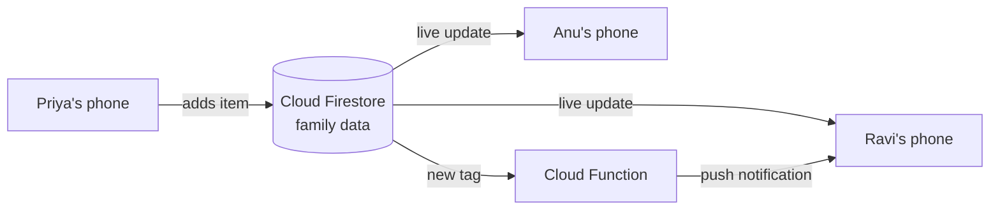

# FamilyConnect — Product Specification (v0.2)

## 0. Decisions confirmed (5 November 2026)

| Topic | Decision |
|---|---|
| Platform | Android only (no iOS at launch) |
| Language | English only |
| Pricing | Free app, no paid tier and no in-app purchases |
| Visual style | Modern, colourful, emoji-led interface (see section 6A) |
| Sign-in | Google account (Gmail) via one-tap sign-in |
| Member pictures | Real profile photos; initials on the member's colour until a photo is added |
| App colours | Six selectable colour themes (Sunrise, Ocean, Forest, Royal, Rose, Night) |

## 1. Purpose

FamilyConnect is a private mobile app for one household. Any member can create a request (a grocery list, a pickup, a medicine schedule or a general reminder), tag one or more family members, and set a time. Tagged members receive a notification, reply "On it", and mark the request done. The person who created the request sees who has acknowledged it and who has completed it.

The app replaces the current mix of phone calls, WhatsApp family groups and verbal reminders, in which requests are lost in chat history and nobody knows who has taken responsibility.

## 2. Users and roles

| Role | Typical member | Main needs |
|---|---|---|
| Organiser | Wife / mother / husband / father | Create lists and reminders, tag others, see status |
| Helper | Husband, older children | Receive tagged tasks, acknowledge, mark done |
| Dependant | School or college students | Ask for pickup or drop with time and place |
| Elder | Grandparents | Medicine reminders in large text, one-tap "Taken" |
| Caregiver | Any adult | Alert when an elder's dose is missed |

Every member belongs to one family group. A member may be marked as an **admin** (can invite or remove members).

## 3. Core features (MVP)

### 3.1 Family group
- Sign in with a Google account (the Gmail account already on the Android phone; one tap, no password or OTP).
- Create a family; invite members with a six-digit invite code or link shared on WhatsApp.
- Each member has a name, relation (Father, Mother, Husband, Wife, Son, Daughter, Grandfather, Grandmother, other) and a profile photo. The Google account photo is used by default and can be replaced from the camera or gallery. Without a photo, the member's initials are shown on their chosen colour.
- Elders without their own phone can be added by an admin as a "managed member": they appear in the family and can receive medicine schedules, while caregivers confirm doses for them.

### 3.2 Grocery and shopping lists
- Checklist items, added by any member at any time.
- Tag the person who will buy; optional "needed by" time.
- Each ticked item shows who ticked it; the creator is notified when the whole list is complete.
- Share the remaining items to WhatsApp as plain text.

### 3.3 Pickup and drop
- Fields: who needs the pickup, location, date and time, tagged driver(s).
- Tagged members are alerted 15 minutes before the pickup time.
- "On it" from one member is visible to the others, so two people do not both go.
- Later phase: live location sharing during the trip.

### 3.4 Medicine reminders
- Fields: medicine name, dose, patient, one to three daily times, end date.
- The patient and tagged caregivers are notified at each dose time.
- Patient or caregiver taps "Taken"; the app records who confirmed it.
- If a dose is not confirmed within 30 minutes, caregivers receive a "missed dose" alert.
- Later phase: refill reminder based on tablet count; photo of the prescription.

### 3.5 General reminders
- Title, date and time, tagged members, optional repeat (daily / weekly / monthly) — e.g. bill payments, school fees, parent–teacher meetings.

### 3.6 Home screens
- **Today**: a single timeline of today's pickups, doses and reminders, with missed and overdue items in red.
- **For me**: everything tagged to the signed-in member, with a "NEW" marker until acknowledged.
- **Family**: all items, filterable by type.
- **Members**: family list, invites and settings.

## 4. Later features (post-MVP)
1. Voice entry ("Remind Ravi to buy milk at 6 pm").
2. Shared family calendar (birthdays, anniversaries, exams).
3. Live location for pickups and an "I have reached" check-in.
4. Elder mode: large text, high contrast, voice read-out of reminders.
5. Expense split for shopping trips.
6. Home-screen widget for today's tasks.
7. Multiple families per user (e.g. own household and parents' household).

## 5. Data model (draft)

```
Family      { id, name, inviteCode, createdAt }
Member      { id, familyId, googleUid, email, name, relation, colour, photoUrl, isAdmin, isManaged, pushTokens[] }
Item        { id, familyId, type: grocery|pickup|medicine|reminder,
              title, notes, createdBy, assignees[], acknowledgedBy[],
              status: open|done, doneBy, due, createdAt }
GroceryLine { id, itemId, text, done, doneBy }
Pickup      { itemId, personId, location }
Medicine    { itemId, patientId, dose, times[], startDate, endDate }
DoseLog     { itemId, date, time, takenBy, takenAt }
Reminder    { itemId, repeat: none|daily|weekly|monthly }
```

## 6. Recommended technology

| Layer | Recommendation | Reason |
|---|---|---|
| Mobile app | Kotlin + Jetpack Compose (Material 3) | Native Android toolkit; direct access to Android exact alarms and notification channels, which medicine and pickup reminders depend on |
| Sign-in | Firebase Authentication with Google sign-in | Every Android phone already has a Google account, so sign-in is one tap; no SMS charges |
| Database | Cloud Firestore | Real-time sync between family members' phones |
| Notifications | Firebase Cloud Messaging + Android AlarmManager | FCM delivers new tags from other members; local exact alarms fire medicine and pickup reminders even when offline |
| Server logic | Cloud Functions (scheduled) | Missed-dose alerts to caregivers |
| Offline | Firestore offline cache | Lists remain usable with poor connectivity |
| Photos | Firebase Cloud Storage | Profile photos, resized on the phone to about 200 × 200 px before upload |

Running costs for a free app: Firebase's no-cost Spark plan covers a small beta; Cloud Functions require the pay-as-you-go Blaze plan, which has a monthly free allowance. Publishing on Google Play requires a one-time developer registration fee. Check current Firebase and Google Play pricing before launch, as both change.

If an iPhone version is wanted later, the data layer (Firebase) can be reused and only the app screens need rebuilding.

## 6B. How syncing works

1. **Sign-in.** Each member opens the app and taps "Continue with Google". Firebase Authentication confirms the account; no separate password is created.
2. **Joining.** The first member creates the family and receives an invite code. Others enter the code (or tap the shared link) and are added to that family.
3. **One shared copy.** The family's members, lists and reminders are stored once in Cloud Firestore, under that family. Every member's phone keeps a live connection ("listener") to it.
4. **Live updates.** When Priya adds "Milk 2 L" to the grocery list, her phone writes the change to Firestore; Ravi's phone receives it, usually within one to two seconds, and the list updates on screen. When Ravi ticks the item, Priya sees the tick.
5. **Notifications.** When someone is tagged, a Cloud Function sends a push notification through Firebase Cloud Messaging to the tagged members' phones, even if the app is closed. Medicine and pickup times are also set as alarms on each phone, so they fire without internet.
6. **Offline.** Without internet, changes are saved on the phone and uploaded automatically when the connection returns.
7. **Privacy.** Firestore security rules allow a signed-in user to read and write only the data of families they belong to.



## 6A. Visual design

The prototype in `prototype/` sets the visual direction for the Android app.

| Element | Specification |
|---|---|
| Header | Gradient in the chosen theme colours (default Sunrise `#FF5F4D` → `#FFA63D`) with the family members' photos |
| Request colours | Grocery green `#18A35F` 🛒 · Pickup blue `#2F7EF0` 🚗 · Medicine pink `#E2457B` 💊 · Reminder violet `#8458F2` ⏰ |
| Member pictures | Circular profile photos; initials on one of six member colours (blue, pink, amber, green, violet, teal) until a photo is added |
| App colours | Six themes selectable in Settings: Sunrise (default), Ocean, Forest, Royal, Rose, Night |
| Typography | Baloo 2 (headings), Nunito (body); both on Google Fonts and usable in Android |
| Shapes | Rounded cards (22 dp radius), pill buttons, bottom navigation with a raised centre "+" button |
| Emoji | One emoji per request type and per action (👍 On it, ✅ Done, 💬 WhatsApp, 🎉 completed) |
| Dark mode | Full dark theme following the phone setting |
| Accessibility | Minimum 48 dp touch targets; colour is always paired with an emoji or text, so status is readable without colour |

## 7. Privacy and safety
- Data is visible only to members of the same family group.
- Medicine data is health information: store it encrypted at rest, allow export and deletion, and follow the Digital Personal Data Protection Act, 2023 (India).
- Children's accounts are created by a parent admin.

## 8. Milestones

| Phase | Scope | Indicative effort |
|---|---|---|
| 0 | Clickable web prototype (this repository, `prototype/`) | Done |
| 1 | Android app: sign-in, family invite, grocery lists, reminders, push notifications | 4–6 weeks |
| 2 | Pickups, medicine schedules, missed-dose alerts | 3–4 weeks |
| 3 | Closed beta with 10–20 families, feedback, Play Store release | 3–4 weeks |

Effort figures are planning estimates for a single developer, not measured values.

## 9. Open questions
1. Should one person be able to belong to two families (e.g. a married daughter who also helps her parents)?
2. App name and icon for the Play Store listing: keep "FamilyConnect" or choose another (check that the name is not already taken on Google Play)?
